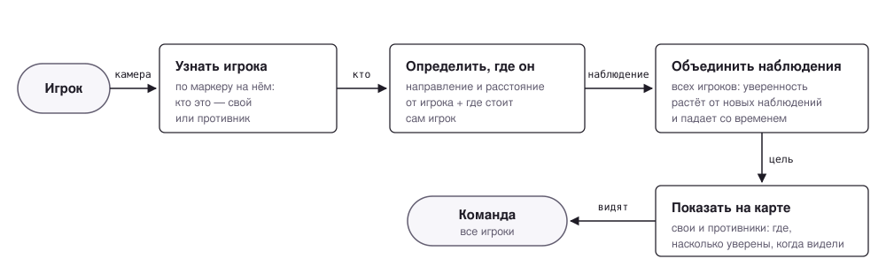
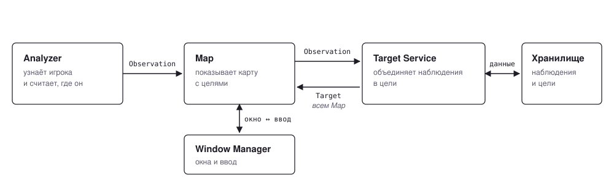
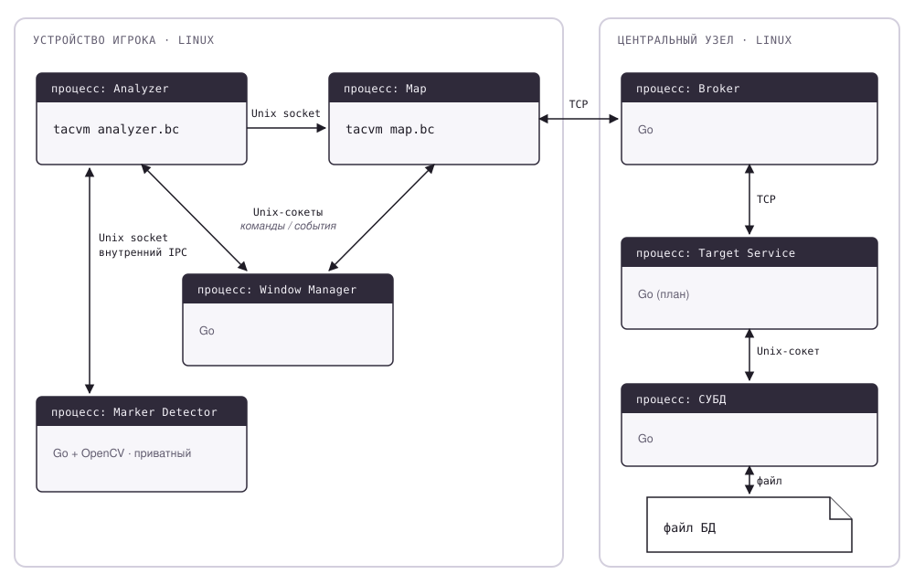
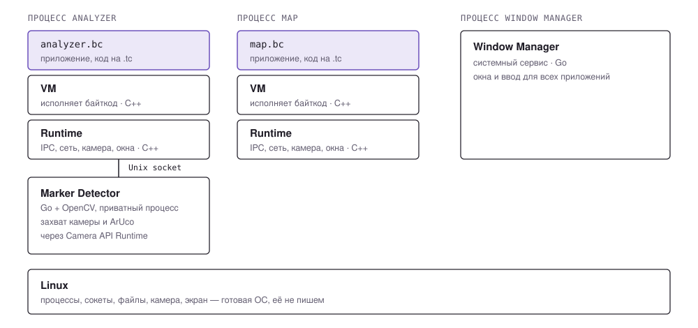
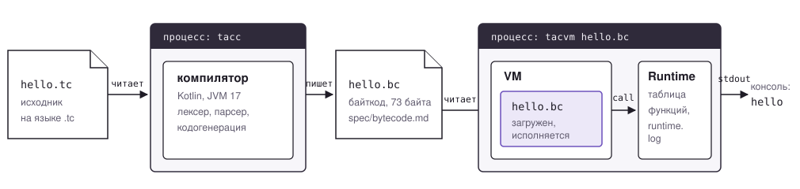
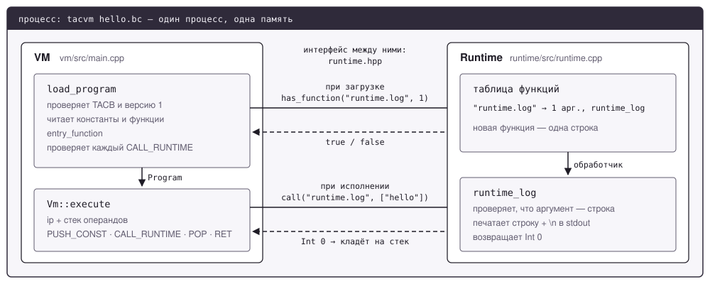

# Tac OS

Инструмент для упрощения обнаружения противника при игре в страйкбол: мобильное приложение распознаёт маркер соперника через камеру и в реальном времени показывает его положение на общей тактической карте команды.

Реализуется как учебный проект — упрощённая Android-подобная платформа поверх Linux, целиком с нуля: свой язык, своя виртуальная машина, свой Window Manager, свой message broker, своя SQL-СУБД. Готовые платформы и сервера использовать нельзя.

## Цель проекта

В рамках проекта планируется реализовать:

- собственный язык программирования;
- компилятор из `.tc` в собственный bytecode `.bc`;
- виртуальную машину для исполнения `.bc`;
- runtime API поверх Linux;
- потоки и IPC;
- Window Manager и Activity lifecycle;
- WebView bridge;
- собственную SQL-СУБД;
- message broker;
- Target Service;
- мобильное приложение для обнаружения противника и отображения его на 2D-карте.

## Стек компонентов

| Слой | Компонент | Роль |
| --- | --- | --- |
| Компиляция | Compiler | Транслирует `.tc` в `.bc` |
| Исполнение | VM | Исполняет `.bc`, вызывает Runtime |
| Системный API | Runtime | Потоки, IPC, камера, геолокация, сеть, WebView bridge — линкуется прямо в процесс VM, отдельным процессом не является |
| Вспомогательный процесс | Marker Detector (Go + OpenCV) | Приватный Linux-процесс на устройстве игрока: камера, ArUco, угол и расстояние; доступен только через Camera API Runtime |
| UI | Window Manager | Отдельный системный процесс на Go: окна и ввод; связь с Runtime через Unix-сокеты |
| Клиент | Analyzer | Процесс Tactical App: получает детекции через Runtime API, вычисляет координаты и формирует `Observation` |
| Клиент | Map | Процесс Tactical App: 2D-карта, приём `Observation` от Analyzer по IPC, приём обновлений от сервера |
| Сервер | Broker | Доставка сообщений по модели publish/subscribe |
| Сервер | Target Service | Агрегирует `Observation` в `Target`, считает вероятность и time decay |
| Сервер | DBMS | Собственная минимальная SQL-СУБД |

Analyzer и Map — два независимых процесса Tactical App, каждый со своей VM и Runtime. Приватный Marker Detector — третий **Linux-процесс на устройстве игрока**, но не третий процесс **Tactical App**: он управляется Runtime, а приложение использует только `camera.detectMarkers()`. Broker, Target Service и DBMS работают на отдельном Linux-устройстве в той же локальной сети — интернет не требуется.

## Требования

Краткая версия для людей. Полная версия с номерами требований, ссылками на спецификации и компоненты — в
[`docs/requirements.md`](docs/requirements.md): именно её читают ИИ-агенты, и при расхождении верна она.

### Для кого

- **Игроки** — хотят быстро и без настроек видеть на одной карте, где противники и где свои.
- **Организатор игры** — хочет поднять систему на площадке на одном компьютере, без интернета, и использовать её
  матч за матчем.
- **Преподаватель (Ключев А.О., ИТМО)** — задаёт жёсткие рамки: вся платформа своя, стек технологий курса.
- **Команда разработки** — работает маленькими проверяемыми шагами, 9 направлений параллельно, срок — начало
  декабря.

### Что умеет система

1. Игрок наводит камеру на другого игрока, приложение распознаёт маркер на нём и понимает, кто это
   (FR-1, FR-2). Распознавание ИИ-моделью — по желанию, маркера достаточно.
2. Приложение определяет, где этот игрок: по направлению, расстоянию и положению того, кто снимает
   (FR-3–FR-5).
3. Система отличает своих от противников, и на карте они показаны по-разному (FR-6).
4. Обнаружение сразу появляется на карте игрока, не дожидаясь сервера (FR-7, FR-8).
5. Обнаружение уходит на центральный узел; он объединяет наблюдения всех игроков в одну цель, уверенность растёт от
   новых наблюдений и падает со временем (FR-9, FR-14–FR-17).
6. Все игроки команды видят на карте себя и цели: где цель, насколько система уверена, когда её видели
   (FR-10–FR-12).
7. Если связь с центральным узлом пропала, приложение не падает и показывает последнее известное (FR-13).
8. Данные хранятся в собственной СУБД и переживают перезапуск (FR-18).

### Ограничения

- Всё своё: язык, компилятор, байткод, VM, Runtime, Window Manager, брокер сообщений, СУБД. Готовые платформы и
  серверы использовать нельзя.
- Стек курса: C/C++ — только VM и Runtime, Kotlin — компилятор, Go или Rust — всё остальное.
- Linux на всех устройствах; клиентом может быть ноутбук.
- Работает в локальной сети площадки, интернет не нужен.

### Что не входит

Своё ядро и сетевой стек, настоящие телефоны, учёт попаданий самими приводами, учётные записи и защита сети,
интернет-сервисы и карты из интернета.

### Что ещё не решено

Правило «тага» и действия после него, поведение без связи с сервером, формулы вероятности, нужна ли история матча, сколько команд и центральных узлов участвует в конкретной игре. Кодирование маркера уже определено: ArUco `DICT_4X4_100`, ID `0..71`, по 12 игроков в каждой из 6 возможных команд. Другие вопросы — в `docs/requirements.md`.

## Архитектура по уровням

Одна и та же система показана на шести уровнях, как в модели OSI: каждая схема отвечает на один вопрос и не
смешивает его с другими. Обозначения и правила обновления схем — в
[`docs/architecture/README.md`](docs/architecture/README.md).

### 1. Бизнес-уровень — что система делает для игроков



### 2. Логический уровень — части системы и данные, которыми они обмениваются



### 3. Уровень процессов — что где запущено и по каким каналам связано



### 4. Уровень платформы — на чём работает приложение на устройстве



### 5. Уровень сборки — как исходник становится программой



### 6. Уровень кода — что внутри процесса `tacvm`



## Мобильное приложение

Пользователь работает с одним Tactical App.

Внутри приложение разделено как минимум на два процесса:

```text
Tactical App
├── Analyzer process
└── Map process
```

`Analyzer` отвечает за:

- получение детекций через `camera.detectMarkers()` (Runtime API);
- чтение координат и ориентации своего устройства;
- вычисление координат цели по углу и расстоянию;
- формирование наблюдения и отправку в Map через IPC.

`Map` отвечает за:

- отображение 2D-карты;
- отображение целей;
- отображение вероятности нахождения цели;
- получение локальных наблюдений через IPC;
- получение обновлений от центрального узла.

Камера и распознавание ArUco обрабатываются приватным вспомогательным процессом на Go.
Он доступен Analyzer только через Runtime API (C++) и локальный Unix-сокет; не является третьим
прикладным процессом. Сам Analyzer работает на `.tc`/VM и отвечает за прикладные вычисления.
Контракт `camera.detectMarkers() -> String` уже утверждён: Runtime временно возвращает JSON-массив детекций как строку, пока VM не поддерживает `Float` и коллекции. Приватный Unix-сокетный обмен с Go-детектором описан в `spec/camera-detector-protocol.md`. Это **утверждённый контракт, но не готовая интеграция**. Использование OpenCV/gocv ещё требует формального согласования с преподавателем.

Analyzer передаёт Map готовый `Observation` с географическими координатами через Unix-сокет (`spec/ipc.md`). Map публикует его в Broker по TCP, где Target Service агрегирует наблюдения и формирует `Target`.

## Центральный узел

Серверная часть запускается на отдельном Linux-устройстве в той же сети.

```text
Client
  ↓
Broker
  ↓
Target Service
  ↓
DBMS
  ↓
Database
```

### Broker

Отвечает только за доставку сообщений по модели publish/subscribe.

### Target Service

Содержит бизнес-логику:

- обработку наблюдений;
- агрегацию данных от нескольких клиентов;
- пересчёт координат цели;
- расчёт вероятности;
- уменьшение вероятности со временем;
- работу с СУБД;
- публикацию обновлений целей.

### DBMS

Собственная минимальная SQL-СУБД на Go, запущенная отдельным процессом. Target Service общается с ней по Unix-сокету: 4 байта длины + SQL-запрос, а в ответе 4 байта длины + JSON (`spec/dbms-protocol.md`).

Она отвечает за:

- разбор поддерживаемого SQL;
- выполнение запросов;
- хранение и чтение данных.

Сейчас исполнитель DBMS работает в памяти. Сокетный сервер и сохранение базы на диск ещё предстоит реализовать.

## Репозиторий

Проект разрабатывается как monorepo.

Планируемые основные каталоги:

```text
compiler/   — язык и компилятор
vm/         — виртуальная машина
runtime/    — runtime API и Linux bindings
system/     — системные сервисы
server/     — DBMS, Broker, Target Service
app/        — мобильное приложение
spec/       — контракты между компонентами
docs/       — архитектура и документация
tests/      — интеграционные и end-to-end тесты
```

## Сборка и тесты

Нужны CMake 3.16+, компилятор C++17 (GCC или Clang) для VM и Runtime и JDK 17 для компилятора `.tc`
(Kotlin, Gradle), а также Go 1.22+ для SQL-СУБД.

```bash
(cd compiler && ./gradlew installDist)
cmake -S . -B build
cmake --build build
ctest --test-dir build --output-on-failure
```

Сборка VM и Runtime с санитайзерами ASan/UBSan, как в CI: `cmake -S . -B build -DTACOS_SANITIZE=ON`
(к компилятору на Kotlin санитайзеры не относятся).

## Работа с репозиторием

- `main` должна оставаться рабочей;
- разработка ведётся в короткоживущих feature-ветках;
- изменения попадают в `main` через Pull Request;
- публичные интерфейсы между компонентами фиксируются в `spec/`;
- архитектурные решения не должны приниматься неявно внутри реализации;
- `.tc` — исходный код и хранится в Git;
- `.bc` — генерируемый bytecode и обычно не хранится в Git.

## Контекст для AI-агентов

Перед работой с проектом AI-агент должен прочитать:

1. `AGENTS.md`;
2. документы в `docs/ai-context/`;
3. `docs/requirements.md` — предметная область и требования;
4. соответствующие спецификации из `spec/`.

Если архитектурное решение ещё не зафиксировано, его нельзя считать принятым по умолчанию.
