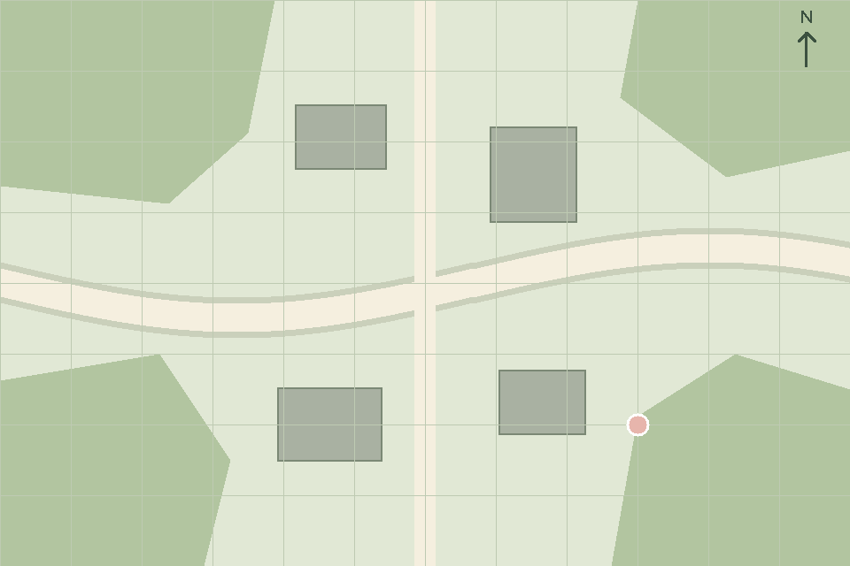

# Map prototype for #35

Go 1.22+ prototype outside the VM. Only the standard library is used.
The offline demo remains available; issue #99 adds a TCP Broker mode with live targets.
Analyzer IPC, aggregation and `.tc` code are not implemented by this increment.

From `app/map`, render the test map locally:

```bash
go run ./cmd/map-demo -preview /tmp/map-preview.png
```

The three visible targets have probability 90%, 55%, and 20%; their marker opacity decreases.
A fourth target is outside the image and is skipped. Edit `DemoTargets()` in `model.go` to change
the hardcoded list. PNG generation interprets the same drawing commands as the WM mode.
It is provided for local inspection. Native drawing integration is verified against WM #80;
see `../../docs/testing/map-wm.md` for the actual Linux SDL2 capture and E2E command.

With the WM drawing commands implemented, open the actual window:

```bash
go run ./cmd/map-demo
```

WM must include the drawing implementation from #80, with the fields in `../../spec/map-rendering.md`.
Use `-socket` and `-events` to change the default Unix socket paths.
Closing the window exits Map; Ctrl+C closes Map's window without stopping the WM service.

The map uses `assets/test-map.png` and its geographic bounds in `assets/test-map.json`.
Coordinates are north-up with east to the right. Inside boundary points use the last valid pixel;
outside points are omitted. The data model matches `spec/data-model.md`, whose approval is unchanged.

Verify coordinates, probability display and frame construction:

```bash
go vet ./...
go test ./...
```

The shared CMake build includes target `tacos_map` and tests `map_unit` and `map_preview`.
The cross-component test `map_wm_e2e` builds the real Map CLI and connects it to the production WM
server/headless renderer. Linux SDL2 operation and native close are recorded in
`../../docs/testing/map-wm.md`. Agreement with the WM owner on the final frame and command fields
was confirmed by the Map owner, and WM #80 has been merged.

## Live Broker mode (#99)

Start the real Broker from the repository root in one terminal:

```bash
cd broker
go run . 8080
```

Start WM in another terminal, also from the repository root. On Debian/Ubuntu, graphical mode
requires `pkg-config` and `libsdl2-dev`:

```bash
cd window-manager
go run -tags sdl ./cmd/wm-server -backend sdl
```

Start Map in a third terminal from the repository root:

```bash
cd app/map
go run ./cmd/map-demo -broker 127.0.0.1:8080 -observations assets/observations.jsonl
```

The map starts with a background and no demo targets. `-observations` is optional: it reads a finite
UTF-8 JSONL fixture, validates every record before starting, and publishes each Observation once.
The payload contains exactly `targetId`, `observerId`, `latitude`, `longitude`, `confidence`,
`timestamp`; the IPC `type` envelope is not accepted. This fixture input is not an Analyzer IPC server.

To observe this publication manually, subscribe **before starting Map**, in another terminal:

```bash
printf 'SUB observations\n' | nc 127.0.0.1 8080
```

With Map running, publish these fixed Target fixtures from another terminal:

```bash
printf 'PUB targets.updated {"targetId":"17","latitude":59.9505,"longitude":30.3095,"probability":0.9,"lastSeenAt":1792255200000}\n' | nc -w 1 127.0.0.1 8080
printf 'PUB targets.updated {"targetId":"17","latitude":59.9495,"longitude":30.3125,"probability":0.2,"lastSeenAt":1792255200001}\n' | nc -w 1 127.0.0.1 8080
```

The same marker moves from (240,160) to (720,480) and becomes paler, in the same window.
Map subscribes to `targets.updated` on the same TCP connection it uses for publication. Each update
replaces that target's stored values by `targetId`, redraws the background and all current targets,
and sends PRESENT. CREATE and SHOW occur only once. Invalid Target records are logged and ignored.
Targets outside the map remain in state but are omitted from the drawing. Other targets are retained.
Map displays the supplied probability; it does not aggregate observations, apply time decay or
implement a target-removal policy. Broker messages are individual Target objects, not lists or envelopes.

The connection attempt and writes have three-second timeouts. If connection fails initially or
disconnects later, Map logs the failure and keeps the last frame (initially only the background).
Window close and Ctrl+C still work. There is **no automatic reconnect, offline queue, resend or
delivery acknowledgement**. Restart Map to reconnect; the last targets are not persisted across
restarts. One-shot fixture messages that fail or whose delivery is uncertain are not replayed.
These are prototype limitations, not changes to `spec/broker-protocol.md`.

`-preview` cannot be combined with Broker flags. Without `-broker`, the original static demo and
PNG-preview behavior are unchanged. The final Tactical App still needs to be implemented on `.tc`;
issue #109 is a separate Float coordinate-calculation increment, not part of #99.

## Broker integration test

From the repository root, without SDL2, camera, Target Service or external services:

```bash
cd window-manager
go test -race -count=1 -v -run '^TestMapBrokerWindowManagerE2E$' ./backend/headless
```

The test builds and starts the actual Broker and Map CLI with the race detector, and runs the real WM server and production
headless renderer. It verifies exact Observation delivery, actual changed pixels and opacity, erased
old marker pixels, multiple targets, out-of-map updates, invalid input, one CREATE/SHOW, connection
loss, an unavailable Broker at startup, and successful CLOSE. No protocol responses are mocked.
The existing Go CI discovers this test, and CTest registers it as `map_broker_wm_e2e`.
The standard-library-only test has no native graphical dependencies. Install Go 1.22+ and a C compiler
for the Go race detector before running it; the test does not download native SDL2 or OpenCV.

## Recorded live Linux SDL2 result

The same Map CLI was also run against the real Broker and WM SDL2 using Go 1.22.12 on Linux arm64,
SDL2 2.26.5, and a virtual X11 display (Xvfb/Openbox in Docker on macOS). These are actual captures
of the native window, without `-preview`:




The window ID remained unchanged; the old marker pixels were erased. Native Alt+F4 while Target
messages were being published closed Map with exit code 0, leaving WM and Broker running.
The [recorded output](../../docs/testing/map-broker/map-output.txt) and
[measured result](../../docs/testing/map-broker/result.json) accompany the captures.
