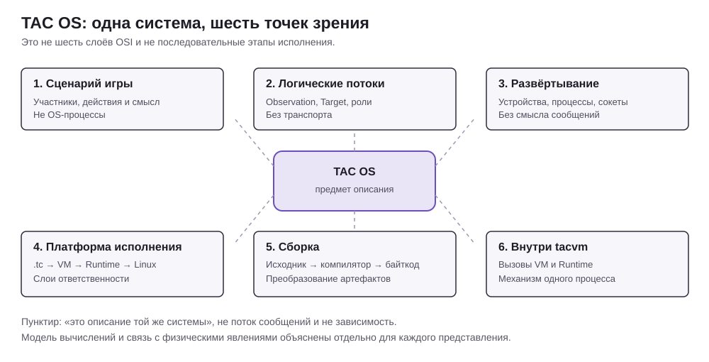

# Architecture diagrams and their semantics

Status: living **viewpoint descriptions** for architecture review (#123).
Keep in sync with `docs/ai-context/01-architecture.md`, authoritative `spec/`,
and the corresponding SVG files.

## Why these are six views, not six layers

Each SVG asks a different question about **the same TAC OS**. This is not
a six-step OSI-like dependency stack. A deployment process, a business
action, a bytecode artifact, a Runtime component and a physical player
are different kinds of thing. Only the platform drawing specifically
depicts layers of execution responsibilities.

See [ontology](ontology.md) for the identity and lifetime of a player,
marker, detection, observation, target, event, value, component and process.

## Model of computation, boundary and real-world correspondence

| Diagram / question | What nodes and links mean | Model of computation / interpretation | Physical or domain referent and omitted details |
| --- | --- | --- | --- |
| [1. Business](1-business.svg): What happens in a game? | Player/team roles, inputs, conceptual game actions and observations. Directed lines are scenario dependencies/flows | Informal **workflow**. The numbered story does not specify the scheduling of software processes, deterministic execution or a formal Petri net | Camera sees a player/marker; device moves and senses a pose; player receives a map. Network timing, implementation, AI inference and optical error are omitted |
| [2. Logical](2-logical.svg): Who exchanges which domain data? | Functional responsibilities and the *types* of data crossing their boundaries (`Detection`, `Observation`, `Target`), not sockets or processes | **Logical data-flow graph**, not a complete executable model. One arrow means a potential data dependency, not synchronous invocation, successful delivery or an imposed total order | Player sightings become reports, confidence decays and a map shows positions. Linux process topology, Broker as intermediary, transmission times and actual player identity are omitted |
| [3. Processes](3-processes.svg): What runs where? | Host frames, Linux process instances and transport channels; socket/file labels specify technologies | **Concurrent independently scheduled OS processes**, communication via Unix streams / TCP, plus persistent file I/O. Channels do **not** by themselves guarantee ordering across senders, acknowledgements or retries; consult IPC/Broker contracts | Linux devices, network signals, cameras and disk. Message/domain meaning, scheduling jitter and physical signal properties are omitted |
| [4. Platform](4-platform.svg): How does the client execute? | Two separate VM hosts, `.tc` code, VM, linked Runtime, underlying Linux; WM and camera helper run separately | **Layered execution**: sequential bytecode interpretation invokes synchronous Runtime operations; Linux provides process scheduling and system mechanisms. This is a dependency view, not a process message-sequence diagram | CPU and OS resources, camera and screen; interrupts, memory layout, physical timings and private helper implementation are omitted |
| [5. Build](5-build.svg): How does source become executable? | Files, running compiler / VM tools; arrows labelled read/write/call | **Artifact transformation workflow**: `.tc` → compile → `.bc` → load/execute. Compilation and VM execution are separate stages; this is not a concurrent application process network | Developer's source text becomes machine-readable bytes and later CPU execution. Real sensors, networking and user actions are not represented |
| [6. Code](6-code.svg): How does VM call Runtime? | Functions/modules and a single process boundary; solid call arrows, dashed return arrows | **Imperative, synchronous call/return** inside one `tacvm` execution (with bytecode dispatch); not an inter-process transport. The example illustrates only `runtime.log` | Actual CPU computes, writes to stdout. OS scheduling, VM parallel contexts and physical display of stdout are outside this diagram |

None of these static diagrams by itself proves that a complete Tactical App has
been implemented. The production Go Map prototype is not the final `.tc`
Map, and a camera fixture is not evidence of successful real AI recognition.

## Local legend inside each SVG

Each drawing now includes its **own** footer legend. The meaning of the same
shape may differ across views; a rectangle is never automatically a "class".
To avoid mixing levels, follow these rules:

- **1 — Workflow:** rounded actor shapes are game roles; parallelograms are
  input/output values; activity blocks are conceptual actions; arrows indicate
  ordering or information flow, *not transport*.
- **2 — Logical:** white rectangles name responsibilities or conceptual
  storage; labelled arrows are domain-data flow; bidirectional links describe
  logical interaction, *not guaranteed calls or TCP channels*.
- **3 — Processes:** large frames are Linux hosts; dark-headed rectangles
  are OS processes; arrows labelled Unix/TCP are transport channels; the
  database sheet is a stored artifact.
- **4 — Platform:** frames denote OS processes, purple blocks hold `.tc`
  application code, other boxes are VM/Runtime/WM components; the Linux
  bottom layer provides mechanisms. A border does not imply a new process.
- **5 — Build:** folded-corner shapes are files, dark-headed boxes are
  tool processes, arrows label read/write/run/call events across stages.
- **6 — Code:** outer frame is one `tacvm` process; inner boxes are
  VM/Runtime or functions; solid arrows are synchronous calls and dashed
  arrows are return values, not IPC.

Status (implemented vs planned) is deliberately **not encoded** by fill color.
Check linked code/tests and GitHub issues before claiming a component is done.

## Invariants for future diagram changes

- Do not put the Broker into the logical domain-data diagram merely because
  the actual transport traverses it; show that in the process view.
- Do not depict Runtime as its own Linux process; it is linked into each VM.
- Do not confuse the `Target` record with a physical player, the ArUco ID
  with global human identity, or a confidence score with a calibrated fact.
- An `Observation` is a reported event/value; its IPC message is one
  transmission of that value. `Target` is derived state with expiry/decay.
- AI recognition and ArUco are separate sources: a vision model cannot
  manufacture `targetId`, distance or geographic coordinates.
- An edge is only meaningful with its semantics: call, data dependency,
  host transport, stage transformation, or return. If the semantics changes,
  update the local SVG legend and the row above.

## What to update on a change

| Change | Update |
| --- | --- |
| Player scenario / confirmed rules | 1, domain ontology |
| Domain flow, schema producer/consumer | 2, ontology, affected specifications |
| Linux process, transport or deployment | 3, process documentation |
| VM/Runtime/OS responsibilities | 4, execution documentation |
| Compiler or bytecode format | 5, compiler/bytecode specification |
| VM/Runtime function-call mechanism | 6, runtime specification |
| Addition of a new viewpoint | overview SVG and this table |

These are hand-maintained SVG files. Text inside diagrams remains in Russian
because the root README embeds them. For a new model element, explain its
kind, lifetime and relationship to reality before drawing an arrow.
