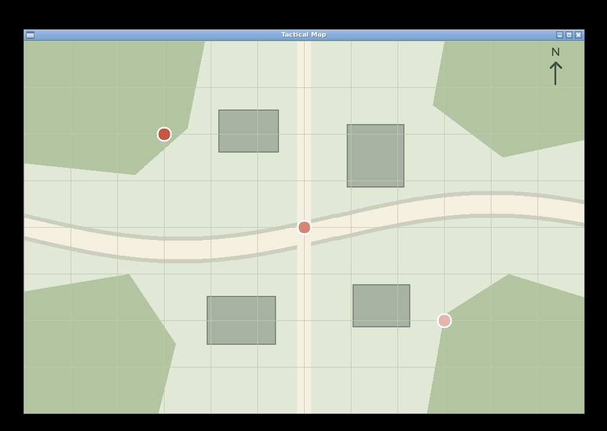

# Map to Window Manager integration (#66)

The Map from #57 is reused unchanged. This increment tests it against the drawing implementation
from WM #80 (`425fd8f857af13b95b62a4a7cd006d9e9c3e5a16`, based on main `448a8a6`).
That dependency must be merged before this integration can be merged into main.
The wire fields and frame below were verified in code and in execution. On 2026-10-21 the Map owner
reported that the WM owner had approved the final frame and command fields in their discussion.

This issue does not implement the `.tc` Map, VM graphics APIs, Analyzer IPC or Broker subscriptions.
It does not repeat the Map or marker-detection prototypes from #57/#58.

## One headless E2E command

Requires Go 1.22+ and a checkout containing WM #80. From the repository root:

```bash
cd window-manager
go test -race -count=1 -v -run '^TestMapClientWindowManagerE2E$' ./backend/headless
```

The test builds and starts the real `app/map/cmd/map-demo` executable, without `-preview`.
The production WM `server.Server` and production `headless.Backend` run in the test process.
The two processes exchange real newline-delimited JSON through command and event Unix sockets.
There are no canned responses or replacement protocol handlers. A test-only backend decorator
records successful calls while delegating every operation to the real renderer and window.

The test verifies:

- `CREATE → BEGIN_FRAME → DRAW_IMAGE → DRAW_CIRCLE` six times `→ PRESENT → SHOW`;
- the real front buffer is visible and 960x640, with the PNG background;
- marker centers at (240,160), (480,320), (720,480), white borders and decreasing red opacity;
- SIGINT to Map produces the actual `CLOSE` command, Map exits successfully, and WM stays alive;
- stopping the test's WM removes both socket files.

It is also registered as `map_wm_e2e` in the shared CTest suite:

```bash
cmake -S . -B build
ctest --test-dir build -R '^map_wm_e2e$' --output-on-failure
```

The existing consolidated Go workflow runs the test in its Window Manager job. No new CI workflow
or service is introduced. The native close-event path is verified separately below.

## Native Linux SDL2 run

On Debian/Ubuntu, install Go 1.22+ and SDL2 development files:

```bash
sudo apt-get update
sudo apt-get install -y build-essential pkg-config libsdl2-dev
```

From the repository root:

```bash
(cd window-manager && go build -tags sdl -o /tmp/tac-wm-sdl ./cmd/wm-server)
(cd app/map && go build -o /tmp/tac-map-demo ./cmd/map-demo)
```

In a terminal in a graphical Linux session:

```bash
/tmp/tac-wm-sdl -backend sdl
```

In another terminal, from the repository root:

```bash
/tmp/tac-map-demo -config app/map/assets/test-map.json
```

This invocation must not include `-preview`: Map sends commands to WM and waits for window events.
The window title is `Tactical Map`; its drawing area is 960x640. Close it with the native close
control. Map prints `Map window closed.` and exits with code 0; WM remains running.

## Recorded Linux result

On 2026-10-21 the real CLI programs were built and run in Debian 12 Linux arm64, Go 1.22.12,
SDL2 2.26.5, using the SDL X11 driver with Xvfb and Openbox in Docker on macOS.
This is native Linux SDL rendering on a virtual X11 display, not a physical Linux monitor and
not a generated PNG-preview displayed in an image viewer.



The [unmodified client-area capture](map-wm/linux-sdl2-client.png) is 960x640.
The [Map output](map-wm/map-output.txt), [environment](map-wm/environment.txt) and
[machine-readable result](map-wm/result.json) accompany the screenshot.

| Target | Center | Probability | Alpha byte | Captured RGB |
| --- | --- | --- | --- | --- |
| t1 | 240,160 | 0.90 | 236 | 200,85,63 |
| t2 | 480,320 | 0.55 | 169 | 215,133,117 |
| t3 | 720,480 | 0.20 | 102 | 231,181,172 |

The capture was compared with a separately generated Map PNG-preview across all 614400 pixels.
The maximum per-channel difference was 1/255 (951 pixels differ), consistent with compositor rounding.
Positions, white borders and opacity ordering match. Closing through Openbox Alt+F4 generated
the real SDL `window_close` event: Map exited with code 0 and WM stayed alive.

To reproduce the virtual-display capture, additionally install:

```bash
sudo apt-get install -y xvfb openbox xdotool imagemagick x11-utils
export DISPLAY=:99 SDL_VIDEODRIVER=x11
Xvfb :99 -screen 0 1040x740x24 -nolisten tcp &
```

After `xdpyinfo -display :99` succeeds, start Openbox and the two binaries in that environment:

```bash
openbox --sm-disable &
/tmp/tac-wm-sdl -backend sdl > /tmp/map-wm.log 2>&1 &
/tmp/tac-map-demo -config app/map/assets/test-map.json > /tmp/map-demo.log 2>&1 &
```

Once `/tmp/map-demo.log` contains `Map shown`, capture and close the actual window:

```bash
map_window_id=$(xdotool search --onlyvisible --name '^Tactical Map$' | head -n 1)
import -window root /tmp/linux-sdl2-desktop.png
import -window "$map_window_id" /tmp/linux-sdl2-client.png
xdotool windowactivate --sync "$map_window_id"
xdotool key alt+F4
```

These display commands are for an isolated test display. Normal desktop operation needs neither
Xvfb nor Openbox installation. Stop the test WM, Openbox and Xvfb after verification.

## Contract review with the WM owner

The exact field agreement is recorded in `spec/map-rendering.md` and `spec/window-manager.md`:
`command`, `window_id`; `title`, `width`, `height` for CREATE; `color` for BEGIN_FRAME;
`image_path`, `x`, `y`, `width`, `height` for DRAW_IMAGE; `x`, `y`, `radius`, `color` for DRAW_CIRCLE;
no additional fields for PRESENT/SHOW/CLOSE. Colors are straight RGBA bytes, source-over composited.
The PNG is full-size at (0,0), circles have white radius 13 behind red radius 10, and rendering occurs
before SHOW. The current WM closes the native window before broadcasting `window_close`.

Technical interoperability has been demonstrated. Following the
[confirmation request](https://github.com/itmo-mobile-app/tac-os/pull/80#issuecomment-6322770833),
the Map owner reported on 2026-10-21 that the final frame and command fields had been discussed with
`@khamitova-prog` and approved. The confirmation was reported from their discussion, rather than
received as a GitHub reply. Merging the WM dependency is still required.
